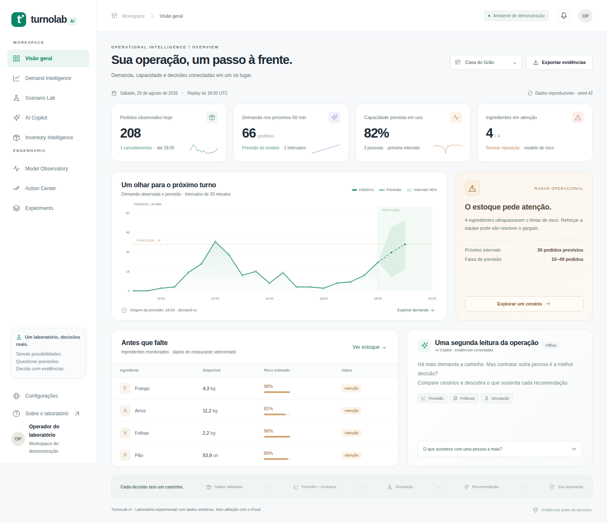
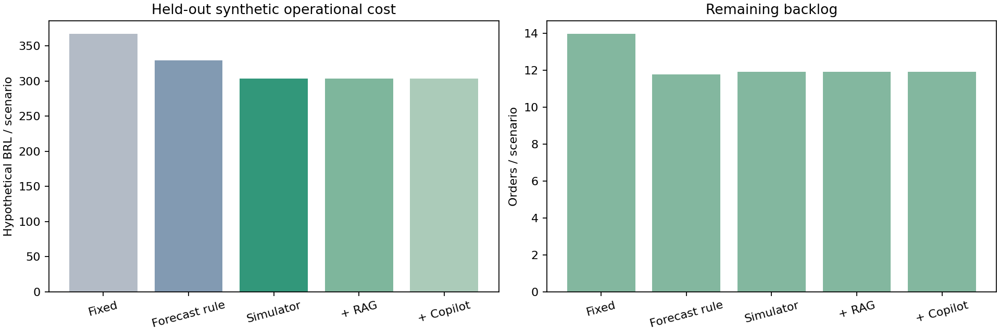
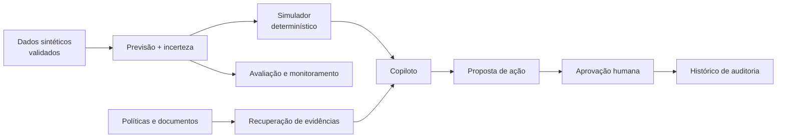

# TurnoLab AI

**Prever um pico de pedidos é apenas o começo. O que importa é decidir o que fazer antes que a fila cresça.**

O **TurnoLab AI** é um laboratório de inteligência operacional para restaurantes fictícios. Combina previsão de demanda, simulação de cenários, análise de estoque e um copiloto capaz de explicar recomendações com base em dados e documentos. A ideia não é automatizar decisões às cegas: é mostrar **as alternativas, as evidências e os limites** antes de alguém aprovar uma ação.

> **Escopo:** projeto experimental, com dados e custos sintéticos. Não representa operações reais, não está vinculado a uma plataforma de delivery e não é um serviço em produção.

[](https://github.com/lucastnunes06/turnolab-ai/actions/workflows/quality.yml)


## Conheça o produto

[](docs/media/dashboard.png)

**[Assistir à demonstração real (GIF, ~91 s)](docs/media/demo.gif)** · [Simulador de cenários](docs/media/scenario.png) · [Copiloto e referências](docs/media/copilot.png)

O fluxo é simples: escolher um restaurante, consultar a previsão, investigar um risco, comparar cenários, pedir uma explicação ao copiloto e registrar uma decisão. As capturas foram produzidas com **Chromium e a API real**, em testes automatizados no GitHub Actions, com transporte do navegador para a aplicação via ASGI. Não são telas ilustrativas com números inventados.

## O que o TurnoLab faz

| Área | O que foi implementado |
| --- | --- |
| **Demand Intelligence** | Previsão de pedidos em horizontes de 30 e 60 minutos, comparação com baselines, intervalos de incerteza e análise de erros. |
| **Inventory Intelligence** | Risco de ruptura de ingredientes, regras e classificação supervisionada, com métricas e limiares de decisão. |
| **Scenario Lab** | Simulação determinística de equipe, capacidade, estoque, fila de pedidos e custos hipotéticos. |
| **AI Copilot** | Perguntas sobre a operação usando ferramentas tipadas, dados estruturados e documentos recuperados. |
| **Action Center** | Propostas pendentes, aprovação ou rejeição humana e trilha de auditoria. |
| **Model Observatory** | Comparação de modelos, versões, latência, erros de previsão e indicadores de drift. |
| **Experiments** | Baselines, experimentos de ablação e análises de sensibilidade reproduzíveis. |

O copiloto tem um **modo offline sem chave de API**. Nesse modo, as respostas usam fatos estruturados, templates e recuperação documental; **não** é uma LLM rodando localmente. Há adaptadores opcionais para provedores externos, ainda não validados com credenciais reais.

## O experimento mais interessante

A pergunta que guiou esta parte do projeto foi: **combinar previsão e simulação produz decisões melhores que uma regra fixa?**

Foram comparadas cinco estratégias em **400 cenários sintéticos**. As hipóteses de custo e capacidade são iguais para cada estratégia; os números abaixo não representam economia real.



| Estratégia | Backlog médio | Custo médio simulado |
| --- | ---: | ---: |
| Regras fixas | 13,98 | R$ 367,37 |
| Regras + previsão | 11,79 | R$ 329,67 |
| **Previsão + simulador** | **11,75** | **R$ 302,34** |
| + Recuperação de documentos (RAG) | 11,75 | R$ 302,34 |
| + Copiloto offline | 11,75 | R$ 302,34 |

**O resultado importa justamente porque não favorece a IA generativa por conveniência.** O ganho numérico veio da previsão e do simulador. RAG e copiloto acrescentam contexto e explicações, mas não melhoraram o custo nem o backlog nesse experimento. Separar papéis de agentes também não mostrou vantagem sobre um fluxo mais simples.

O teste encontrou um defeito importante: a política fictícia de no máximo duas pessoas extras foi violada em **2,25% dos cenários**. Esse limite não foi escondido e precisa ser resolvido antes de tratar a política como confiável.

[Protocolo experimental](docs/experiments/protocol.md) · [Dados por cenário](reports/decision_scenarios.csv) · [Análise técnica](docs/article/turnolab.md)

## Modelos: resultados e limites

Os modelos foram treinados e comparados sobre dados gerados com seed documentada: **20 restaurantes, 90 dias e 86.400 intervalos de 30 minutos**. A avaliação usa divisão temporal, seleção na validação e teste posterior, com atenção ao vazamento de informações futuras.

| Horizonte | Modelo selecionado | MAE no teste | RMSE | WAPE |
| --- | --- | ---: | ---: | ---: |
| 30 minutos | Gradient Boosting · 31 folhas | 2,886 | 5,981 | 29,64% |
| 60 minutos | Gradient Boosting · 31 folhas | 2,925 | 6,051 | 30,01% |

O melhor modelo foi selecionado com dados de validação; os resultados acima pertencem ao **teste sintético**. A diferença para Random Forest é pequena e não justifica alegar superioridade universal.

**Uma limitação particularmente relevante:** os intervalos nominais de 90% alcançam **90,08% de cobertura agregada**, mas apenas **82,38% durante o funcionamento** dos restaurantes. Horários fechados, com demanda zero, favorecem a métrica geral. O problema está documentado; recalibrar usando o mesmo teste invalidaria a comparação.

No estudo de estoque, o classificador teve **F1 de 0,838** e **PR-AUC de 0,933** no teste sintético, contra **F1 de 0,736** e **PR-AUC de 0,822** para a regra de referência. Esses resultados não devem ser extrapolados para restaurantes reais.

[Metodologia de ML](docs/ml-methodology.md) · [Model Card](docs/MODEL_CARD.md) · [Relatórios](reports/)

## Como as peças se conectam



As decisões numéricas pertencem ao **modelo e ao simulador**, não à LLM. O copiloto pode consultar informações, simular cenários e propor ações, mas não aprova propostas nem altera estoque diretamente. A aprovação, nesta demonstração, registra uma decisão — não dispara uma operação comercial.

A arquitetura usa Python, **FastAPI**, Pydantic, SQLite, NumPy, pandas, scikit-learn e interface em **JavaScript/CSS nativos**. Foi escolhida uma estrutura modular com poucas dependências obrigatórias. O frontend **não é React**; o armazenamento local **não é PostgreSQL**. Essas escolhas e seus trade-offs estão nos [registros de decisão](docs/decisions/ADRs.md).

## Rodar no computador

**Pré-requisitos:** Python 3.12 recomendado, Git e um ambiente com CPU. Não exige GPU, provedor externo de IA ou credenciais para a demonstração.

```bash
git clone https://github.com/lucastnunes06/turnolab-ai.git
cd turnolab-ai

python -m venv .venv
source .venv/bin/activate
pip install -r requirements.txt

python scripts/bootstrap.py
python -m uvicorn backend.app.main:app --host 127.0.0.1 --port 8000
```

No Windows PowerShell, ative o ambiente com `.venv\Scripts\Activate.ps1`.

- **Aplicação:** http://127.0.0.1:8000
- **Documentação da API:** http://127.0.0.1:8000/docs

O primeiro bootstrap gera os dados sintéticos, treina os modelos em CPU e prepara o ambiente. Ele leva mais tempo do que iniciar o servidor, mas funciona sem modelos binários versionados. O estado inicial da demonstração usa um replay fixo de **29/08/2026**, não informações do dia atual.

Alternativa com Docker Compose:

```bash
docker compose up --build
```

O container foi construído e testado no GitHub Actions, incluindo chamadas HTTP de prontidão. Para opções de configuração e cuidados com volumes, consulte o [guia local](docs/local-run.md) e o [guia Docker](docs/deploy.md).

> **Segurança:** `turnolab-demo` e `turnolab-other` são tokens públicos de demonstração. Não exponha esse modo como autenticação real. Os arquivos `.joblib` devem ser carregados somente de fontes confiáveis.

## Testes e reprodutibilidade

Depois do bootstrap:

```bash
python scripts/check.py
python scripts/reproduce_data.py
```

Com Node.js instalado, `scripts/check.py` executa os testes de Python e frontend, verificações estáticas e build. Na CI foram aprovados **49 testes Python e 13 testes frontend**, além de lint, análise de segurança e verificação das dependências.

Também há verificações específicas:

```bash
python scripts/load_check.py       # Carga local via ASGI
python scripts/browser_check.py    # Fluxos reais no Chromium/Playwright
python scripts/reproduce.py       # Retreinamento integral; exige mais CPU/tempo
```

Os modelos binários, logs e CSVs extensos de previsões individuais não são mantidos no GitHub: o bootstrap os recria. Dados, artefatos e avaliações agregadas possuem referências e documentação para auditoria.

**Evidências verificadas remotamente:**

- [Testes, frontend e navegação em Chromium](https://github.com/lucastnunes06/turnolab-ai/actions/runs/40726044887)
- [Docker Compose e registro de experimentos com MLflow 3.5.1](https://github.com/lucastnunes06/turnolab-ai/actions/runs/40726836196)
- [Geração da demonstração com navegador real](https://github.com/lucastnunes06/turnolab-ai/actions/runs/40727621782)
- [Relato técnico das verificações e ressalvas](docs/CI_EVIDENCE_2026-10-28.md)

O MLflow foi executado **no runner da verificação estendida**, com armazenamento local de métricas e artefatos. Isso não significa um servidor MLflow permanente, nem rastreamento de produção. O navegador exercitou o backend real por ASGI; não é um benchmark de latência HTTP de ponta a ponta.

## Onde olhar no código

| Se você quer entender… | Comece aqui |
| --- | --- |
| Geração e qualidade de dados | [`ml/data.py`](ml/data.py), [`docs/data-and-features.md`](docs/data-and-features.md) |
| Treinamento e avaliação | [`ml/train.py`](ml/train.py), [`ml/stock.py`](ml/stock.py) |
| Simulador operacional | [`simulator/engine.py`](simulator/engine.py) |
| API, autenticação demonstrativa e propostas | [`backend/app/`](backend/app/) |
| Recuperação de documentos e ferramentas do copiloto | [`ai/`](ai/) |
| Frontend | [`frontend/`](frontend/) |
| Experimentos e ablações | [`ml/experiments.py`](ml/experiments.py) |
| Arquitetura e decisões | [`docs/architecture/`](docs/architecture/), [`docs/decisions/`](docs/decisions/) |

## O que ainda não está resolvido

O TurnoLab é um **ambiente de pesquisa e demonstração**, não uma plataforma pronta para restaurantes reais. Há limitações importantes:

- Os dados, políticas e custos são sintéticos; não existe validação externa nem ganho financeiro comprovado.
- A cobertura dos intervalos piora justamente durante a operação; é necessário um **novo período de teste** para avaliar recalibração sem contaminar o holdout atual.
- O simulador ainda possui violações de uma restrição fictícia em parte dos cenários.
- O RAG foi avaliado com um conjunto pequeno de desenvolvimento; não há avaliação humana independente.
- A integração com provedores externos de LLM não foi validada com credenciais reais.
- Hugging Face e n8n têm artefatos ou fluxos preparados, mas **não foram publicados ou executados de ponta a ponta**.
- Docker, MLflow e GitHub Actions foram verificados nos escopos descritos acima; isso não equivale a deploy público nem a segurança de produção.

Os próximos experimentos são melhorar a calibração nos horários abertos, testar políticas sob dados novos, tornar o estado do estoque mais contínuo e avaliar a qualidade das justificativas com um corpus mais amplo.

[Limitações e roadmap](docs/limitations-and-roadmap.md) · [Segurança](docs/security/README.md) · [Relatório da auditoria](docs/AUDITORIA_FINAL_2026-10-28.md)

---

**TurnoLab AI** · Projeto experimental e de código aberto · [Licença MIT](LICENSE)

*Uma boa previsão é útil. Uma decisão que pode ser explicada, testada e contestada é melhor.*