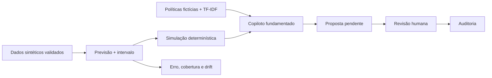

# TurnoLab AI

**O restaurante está prestes a receber mais pedidos do que consegue preparar. O que fazer antes que a fila cresça?**

TurnoLab AI é um laboratório de decisões operacionais: combina previsão de demanda,
incerteza, simulação e um copiloto que explica evidências. Permite testar uma hipótese
antes de propor uma ação e deixa visíveis os modelos, os dados, os custos e os limites.

*Demand Forecasting, Operational Intelligence & AI Copilot for Restaurants*

> Projeto de portfólio com dados sintéticos. Sem afiliação com o iFood, sem dados
> internos, sem operação real e sem publicação externa realizada.

**Estado verificável:** modelos treinados, API exercitada em ASGI, simulador e
copiloto offline integrados, oito telas conectadas, testes locais aprovados.
**Entrega integral ainda pendente:** navegador/capturas/GIF, Docker, MLflow e CI
remota não foram verificados neste ambiente. A API HTTP/TCP local foi exercitada com sucesso. Consulte [critérios e pendências](docs/acceptance.md).

## Um resultado que não favorece a IA por conveniência


| Estratégia | Backlog médio | Custo médio hipotético |
|---|---:|---:|
| Regras fixas | 13,98 | R$ 367,37 |
| Regra + previsão | 11,79 | R$ 329,67 |
| Previsão + simulador | 11,75 | R$ 302,34 |
| + RAG | 11,75 | R$ 302,34 |
| + copiloto offline | 11,75 | R$ 302,34 |

O simulador escolhe ações usando previsões e avalia com demanda futura de teste.
RAG e copiloto usam a mesma decisão numérica: acrescentam suporte documental,
sem receber crédito pelos cálculos. O solver violou a política fictícia de no
máximo duas pessoas extras em 2,25% dos cenários; o experimento reporta esse limite.

Estes custos são **hipóteses do simulador**, não economia realizada. [Protocolo](docs/experiments/protocol.md),
[registros por cenário](reports/decision_scenarios.csv), [sensibilidade](reports/decision_sensitivity.csv).

## Ver a aplicação

A UI local tem Visão geral, Demand Intelligence, Scenario Lab, AI Copilot,
Inventory Intelligence, Model Observatory, Action Center e Experiments.

**Captura real e GIF: pendentes.** O Chromium iniciou nesta auditoria, mas a
navegação foi bloqueada por uma política do ambiente (`ERR_BLOCKED_BY_ADMINISTRATOR`). Não há imagem de mock apresentada
como captura. [O teste Playwright](scripts/browser_check.py) e [o roteiro de 90s](docs/demo-script.md)
estão prontos para gerar evidências a partir da interface e API reais quando o
navegador puder navegar. A figura acima é um gráfico experimental, não uma screenshot.

## Executar sem credenciais externas

```bash
python -m venv .venv
. .venv/bin/activate
pip install -r requirements.txt
python scripts/bootstrap.py
python -m uvicorn backend.app.main:app --host 127.0.0.1 --port 8000
```

Interface: **http://127.0.0.1:8000** · OpenAPI: **http://127.0.0.1:8000/docs**.
O replay padrão é 29/08/2026, 18:00 UTC. A UI usa `turnolab-demo`; em Configurações,
`turnolab-other` demonstra escopo restrito ao restaurante 2. Esses tokens são
públicos e exclusivos da demo. Não exponha a aplicação como serviço autenticado real.


**Nota sobre o clone público:** os modelos binários `.joblib`, os CSVs extensos de previsões por evento e os logs de execução não são versionados. O comando `python scripts/bootstrap.py` recria os modelos e os dados locais. Os resultados agregados e a metodologia permanecem documentados no repositório.

O bootstrap gera dados se ausentes, treina modelos em CPU e registra avaliações.
Não sobrescreve um banco povoado nem apaga decisões. [Guia completo](docs/local-run.md).
Docker/Compose foi preparado, mas o build ainda precisa ser validado: [deploy](docs/deploy.md).

## O caminho de uma decisão



A LLM é opcional e nunca é fonte primária de números. O modo offline usa templates,
fatos estruturados e citações; não é uma LLM local. O agente pode consultar, simular
e propor. Não altera estoque, executa shell/SQL livre ou aprova recomendações.
A aprovação apenas registra a decisão nesta demonstração.

## O que foi implementado e medido

- **Dados:** 20 restaurantes × 90 dias, 86.400 intervalos, 86.240 snapshots; seed e
  SHA-256. Picos, promoções, ruído, eventos atípicos e mudança de comportamento.
- **Demanda:** quatro baselines e três candidatos de ML/configuração, +30/+60,
  separação temporal com purge, walk-forward, resíduos e métricas por segmento.
- **Estoque:** regra, classificador calibrado e híbrido. Previsões fora da amostra
  geradas por previsor congelado antes do treino do classificador.
- **Simulação:** fila fluida, capacidade limitada por equipe/cozinha/estoque,
  reposição com prazo, custos e sensibilidade. Entradas e resultados persistidos.
- **Assistência:** ferramentas tipadas, RAG com referências abríveis, abstenção,
  papéis limitados e adaptadores externos com fallback. Provedor externo não executado.
- **API:** escopo por restaurante, paginação, request IDs, logs JSON, propostas,
  aprovação/rejeição, auditoria append-only, métricas e PSI.
- **MLOps local:** ledger de experimentos, champion/challenger real, checksum,
  gate por validação e rollback testado. MLflow permanece integração opcional pendente.

## Resultados de ML e uma falha importante

| Horizonte | Champion | MAE | RMSE | WAPE |
|---|---|---:|---:|---:|
| 30 min | Gradient Boosting · 31 folhas | 2,886 | 5,981 | 29,64% |
| 60 min | Gradient Boosting · 31 folhas | 2,925 | 6,051 | 30,01% |

No horizonte de 30 min, último intervalo teve MAE 4,362; sazonal 4,435; Ridge
3,412; Random Forest 2,911. O melhor modelo foi escolhido **pela validação**,
antes de consultar teste. A diferença contra Random Forest é pequena.

Os intervalos nominais de 90% cobrem 90,08% no agregado, mas só **82,38% durante
funcionamento**. Os zeros de horários fechados escondem a subcobertura operacional.
Esse alerta aparece na UI e não foi “corrigido” usando o teste.

No risco de estoque, a regra teve recall 73,63%, F1 0,736 e PR-AUC 0,822; o
classificador teve recall 92,95%, F1 0,838 e PR-AUC 0,933, no teste sintético.
Não extrapolar esses resultados para restaurantes reais.

No RAG lexical de desenvolvimento: Hit@3 18/19, precisão documental 77,8% e
abstenção 4/4 negativas. A primeira versão falhou nas negativas; o relatório foi
preservado. Separar papéis não trouxe ganho demonstrado sobre tool calling simples.

[ML](docs/ml-methodology.md) · [RAG e agentes](docs/rag-and-agents.md) ·
[relatórios JSON/CSV](reports/) · [Model Card](docs/MODEL_CARD.md).

## Stack e escolhas proporcionais

Python 3.12, FastAPI, Pydantic, SQLite (`sqlite3`), NumPy, pandas, scikit-learn,
joblib e Matplotlib. Interface em JavaScript ESM, CSS e SVG, com contratos `.d.ts`.
Sem dependências JavaScript de runtime. Testes em unittest e Node; Playwright preparado.

React/Vite/Tailwind e SQLAlchemy/Alembic eram preferências; pacotes não disponíveis
foram substituídos por implementação local mais simples. **Não é uma UI React nem
uma API SQLAlchemy.** Docker, GitHub Actions, n8n e MLflow têm arquivos/adaptadores;
execução não comprovada está marcada como pendente. [ADRs](docs/decisions/ADRs.md).

## Testar e reproduzir

```bash
python scripts/check.py       # 49 testes Python + 13 de frontend; build e guardrails
python scripts/load_check.py  # carga medida em ASGI; não mede TCP
python scripts/reproduce_data.py  # seis CSVs regenerados, SHA-256 e schema
python scripts/reproduce.py       # re-treinamento integral; requer mais tempo/CPU
python scripts/browser_check.py  # requer Chromium permitido
python scripts/capture_demo.py   # GIF real de ~90s; requer Pillow e Chromium
```

Os testes cobrem dados inválidos, futuro adulterado, fronteiras temporais,
conservação de pedidos, entrega que não chega antes do prazo, autorização,
contratos, injeção, fallback, aprovação humana e rollback. Os testes de componentes
usam uma fixture **produzida pela API real**; não substituem teste de navegador.
Não foi inventado percentual de cobertura.

Carga registrada: 80 requisições ASGI, concorrência cooperativa 4, zero erros; os números
exatos e limites estão em [load.json](reports/load.json). [Checks locais](reports/checks.json)
não são execução remota de GitHub Actions. O workflow está em `.github/workflows/`.

## Explorar o repositório

| Área | Onde começar |
|---|---|
| Dados, features e modelos | `ml/data.py`, `ml/features.py`, `ml/train.py`, `ml/stock.py` |
| API e decisões | `backend/app/main.py`, `services.py`, `migrations/` |
| IA e documentos | `ai/tools.py`, `coordinator.py`, `providers.py`, `rag.py`, `corpus/` |
| Matemática operacional | `simulator/engine.py` |
| Produto | `frontend/app.js`, `styles.css`, `contracts.d.ts` |
| Experimento | `ml/experiments.py`, `reports/decision_scenarios.csv` |
| Arquitetura e decisões | [arquitetura/ER](docs/architecture/README.md), [ADRs](docs/decisions/ADRs.md) |
| Portfólio | [artigo](docs/article/turnolab.md), [matriz para a vaga](docs/competency-matrix.md), [entrevista](docs/interview-guide.md) |
| Model Card e artefato local | `docs/MODEL_CARD.md`, `artifacts/huggingface/` |

## Limites e próximos passos

Não há usuários reais, economia de horas comprovada, causalidade de promoções,
produção, publicação em GitHub/HF, pesquisa com humanos ou dados privados.
O gerador e o simulador compartilham hipóteses. Tokens são de demo; o dono do
arquivo SQLite pode alterar a auditoria. Artefatos joblib devem ser confiáveis.

Prioridades: novo holdout para calibração, estoque contínuo, RAG cego, validação
externa dos adaptadores, browser/containers/MLflow/CI, identidade real e migração
da stack quando justificável. [Limitações completas](docs/limitations-and-roadmap.md),
[segurança](docs/security/README.md), [aceitação](docs/acceptance.md).

## Vaga, referências e transparência

A descrição oficial do [Programa de Estágio — GenAI](https://job-boards.greenhouse.io/ifoodcarreiras/jobs/8901054002)
foi consultada em **28/10/2026**. Integração de software e operacionalização de IA/LLMs
são o núcleo observado; RAG, conformal, observabilidade e bibliotecas específicas
são escolhas adicionais deste projeto. [Fonte e separação de competências](docs/job-source.md).

Referências técnicas: [HistGradientBoosting](https://scikit-learn.org/stable/modules/ensemble.html#histogram-based-gradient-boosting),
[conformal prediction](https://arxiv.org/abs/2107.07511), [FastAPI](https://fastapi.tiangolo.com/),
[SQLite](https://www.sqlite.org/docs.html). As referências orientam métodos; os
resultados deste repositório vêm das avaliações locais, não dessas páginas.

**Assistência de IA:** código, testes e documentação foram produzidos com ajuda
substancial de IA. O candidato precisa revisar, executar, modificar e compreender
as partes que pretende apresentar. Este artefato não comprova implementação
individual ou experiências profissionais que o candidato não teve.

Licença MIT · dados sintéticos · execução local.

Verificação final automatizada (inclui bootstrap em extração limpa): `python scripts/release_check.py`. Consulte
[o guia](docs/final-verification.md) e [o resultado observado](reports/release.json).
O verificador recusa marcar a entrega como completa enquanto houver requisito
bloqueado; nenhuma etapa é aprovada apenas porque seu arquivo existe.
