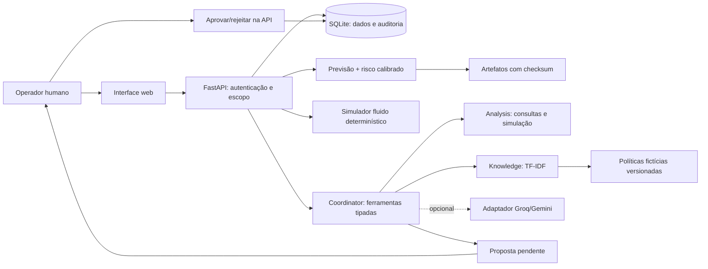
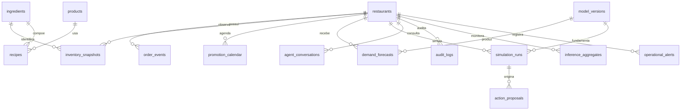

# Arquitetura: um monólito com fronteiras explícitas

O usuário seleciona um restaurante e recebe um snapshot de replay. O frontend
consulta FastAPI; a API aplica autorização e chama módulos numéricos e de
conhecimento. SQLite guarda dados e decisões. Artefatos locais contêm modelos
congelados. Nenhuma LLM gera a previsão, resolve a fila ou aprova a proposta.

## Limites e contratos

- `ml/data.py`: gerador, validação e ingestão. Fatos sintéticos, sem dados pessoais.
- `ml/features.py`: origem e alvo separados. Toda observação tem tempo <= origem.
- `ml/train.py` e `ml/stock.py`: escolha por validação, calibração posterior e teste.
- `simulator/engine.py`: regras de conservação; Pydantic rejeita entradas inválidas.
- `ai/tools.py`: allowlist e autorização a cada chamada. Não há SQL, shell ou HTTP
  livre. O modo externo não escolhe ferramentas: explica evidências selecionadas.
- `backend/app/services.py`: transações de simulação, proposta e decisão humana.
- `frontend/`: aplicação sem dependências de runtime, com SVG e JavaScript nativo.

Os papéis Analysis/Knowledge/Coordinator são funções dentro do mesmo processo.
Não se afirma haver três agentes autônomos. A comparação com tool calling simples
é uma ablação nula: mesmos fatos, orquestração equivalente.

## Modelo relacional

`experiment_runs` é o ledger técnico independente de tenants. `schema_versions`
registra migrations. IDs, quantidades não negativas, status de proposta e
unicidade de snapshots/origens têm constraints. A auditoria impede UPDATE/DELETE
por triggers. Isso não é um log criptograficamente inviolável: quem controla o
arquivo SQLite pode alterar o banco fora da aplicação.

Migrations são SQL confiável do repositório, executadas em transação por versão.
O SQL de consultas usa parâmetros. Os nomes de tabelas na ingestão vêm de uma
allowlist de código, nunca de texto do usuário ou de uma LLM.

## Operação local

Um processo atende a demonstração. A API usa rotas assíncronas, mas inferência e
SQLite são síncronos no event loop; não há promessa de throughput de produção.
O teste de carga ASGI mede essa configuração e exclui custo de rede. Evoluir para
workers e fila de inferência exige medir concorrência e limites do banco.

Não há implantação em produção, autenticação corporativa, mensageria distribuída,
estoque transacional real ou execução de ações em sistemas de restaurantes.
